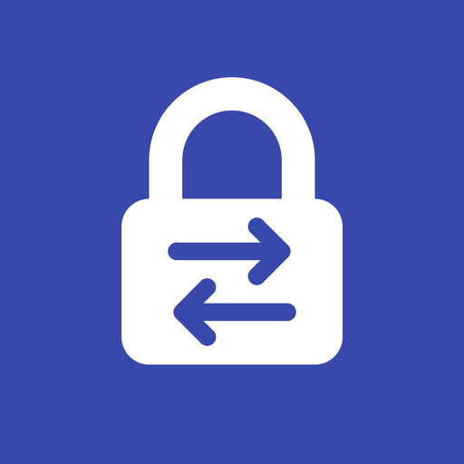

# Login Relay

Sign in to Android apps on a phone that has no web browser.

Many apps (any that use Auth0, AppAuth, or similar) open their sign-in page in a browser or Custom
Tab. On a phone without a browser — a flip phone, a kosher or kids' phone, a debloated ROM — the
app checks for one, finds none, and fails with a generic "Authentication failed" before it sends a
single request.

Login Relay fixes that without putting a browser on the phone:

```
 phone                                   computer (over adb)
 app: "open the sign-in page"
 Login Relay answers as the browser ──▶  the desktop app opens the page in your normal browser
                                          you sign in there
                                          the site redirects to the app's return address
                                          the desktop app catches it (temporary URL handler)
 app finishes the sign-in itself   ◀──   adb shell am start <return address> -p <app>
```

The page never loads on the phone. The app finishes the login with its own code, so it stores the
session exactly as it would after a normal login.

## Use it

### macOS: the menu bar app

1. Download `Login-Relay-macOS-<version>.zip` from [Releases](https://github.com/clippycoder/oauth-relay/releases),
   unzip, and move **Login Relay** to Applications.
2. The app isn't notarized (there's no paid Apple developer account behind it), so macOS blocks the
   first launch. Right-click the app and choose **Open**, or on recent macOS open System Settings →
   Privacy & Security and choose **Open Anyway**. Or clear the flag once:
   `xattr -dr com.apple.quarantine "/Applications/Login Relay.app"`.
3. Plug the phone in with USB and turn on USB debugging (Settings → Developer options). Accept the
   "Allow USB debugging?" prompt on the phone.
4. A lock icon appears in the menu bar. If adb isn't installed, the menu offers to download Google's
   platform-tools (checked against Google's published checksum). If Login Relay isn't on the phone,
   the menu offers **Install Login Relay on Phone**; the phone app is bundled in the Mac app.
5. Sign in to an app on the phone as usual. When it opens the sign-in page, Login Relay sends it to
   your Mac, and your browser opens it. Sign in, and allow the browser to open "Login Relay" when it
   asks. The app on the phone finishes the login.

The menu shows the phone's state and has **Launch at Login**, **Show in Dock** (off by default, so it
lives only in the menu bar), and **Notify When a Sign-in Arrives**. **Show Activity…** opens a window
with a log.

### Linux and Windows: the command-line helper

Native Linux and Windows apps are planned. Until then, the same job is done by a Python script. With
Login Relay installed on the phone (`adb install login-relay-<version>.apk`, or through your MDM) and the
phone connected over adb, run:

```
gh api -H 'Accept: application/vnd.github.raw' repos/clippycoder/oauth-relay/contents/relay.sh | sh
```

The repo is private for now, so the one-liner goes through `gh`. Once the repo is public it becomes
`curl -fsSL https://raw.githubusercontent.com/clippycoder/oauth-relay/main/relay.sh | sh`. `relay.sh`
downloads `host/oauth_relay.py` and runs it, so `python3` must be installed. To pass options, use
`… | sh -s -- --serial 1234ABCD`. From a clone, run `./relay.sh` or `python3 host/oauth_relay.py`.
Options: `--serial` picks a phone, `--paste` skips the URL handler and you paste the final address by
hand, `--yes` skips the warning for sign-ins without PKCE. The Linux and Windows URL handlers in the
script are untested.

Links that aren't sign-ins, such as a "terms of service" link, also open on the computer.

## How it stays safe

- **PKCE.** Most sign-ins send a `code_challenge` and keep the matching secret on the phone. The
  code that passes through the computer can't be redeemed without that secret. The app warns
  and asks before relaying a sign-in that doesn't use PKCE.
- **State check.** The computer only accepts a return address whose `state` matches the sign-in it
  opened, and it ignores anything else.
- **Delivered only to the app that asked.** The return address goes back with `-p <package>` of
  the app that opened the page.
- **Only adb can talk to the phone app.** Login Relay serves on an abstract unix socket, and it
  refuses peers that aren't the `shell` or `root` user, so other apps can't read the pages.
- **Nothing left behind on the computer.** The URL handler is registered for one login and then
  removed. If another app already handled that scheme, it is restored.

## How the computer catches the redirect

| OS | Mechanism | Status |
|---|---|---|
| macOS | The running app claims the scheme with LaunchServices for one login and restores the previous handler afterwards (a claim left by a crash is cleaned up on the next launch). It receives the URL as an Apple event, so no helper app is needed. | tested |
| Linux | A `.desktop` file with `x-scheme-handler/<scheme>` and `xdg-mime default`, restored afterwards | untested |
| Windows | `HKCU\Software\Classes\<scheme>` pointing at a tiny `pythonw` handler, with the previous key backed up and restored | untested |

Apps that return to an `https://` address (Android App Links) can't be caught this way. For those,
the app asks you to paste the final address from the browser's address bar. It does the same if macOS
refuses the claim.

## Managed phones (MDM)

Login Relay is an ordinary app with no permissions, so it can be distributed through an MDM like
any other in-house APK. An MDM that removes sideloaded apps will also remove a copy installed with
`adb install`, so add it through the console instead.

| | |
|---|---|
| Package | `io.github.clippycoder.oauthrelay` |
| Signing certificate SHA-256 | `d4:3d:3e:98:27:12:3a:56:f0:92:39:e5:32:40:a6:94:b1:ff:8a:3f:73:af:0a:a7:2d:92:e5:42:a1:40:c8:b4` |
| Permissions | none |
| Icon for the console | [`docs/icon-512.png`](docs/icon-512.png) |

The phone also needs USB debugging (or wireless debugging) allowed while you sign in, because the
hand-off runs over adb.

## Limits

- Apps that check for a specific browser package, or that require a working Custom Tabs service,
  may still refuse.
- Some sign-ins cancel if the app's own screen is resumed before the result arrives. Login Relay
  keeps the screen on while it waits, so a screen lock doesn't cancel the login.
- Low-memory phones kill background apps quickly, and an app killed mid-login forgets the login it
  started. Login Relay is therefore a translucent sheet over the app rather than a full screen. That
  keeps the app "visible" to Android (oom_score_adj 100 rather than 700), so it isn't a kill target
  while you sign in.

## Build

```
android/build.sh              # phone app: bare SDK tools (aapt2, javac, d8, zipalign, apksigner); no Gradle
android/tools/make_icons.py   # re-render the icons after changing the design (needs Pillow)
macos/Tests/run.sh            # unit tests for the sign-in parsing logic
macos/build.sh                # Mac app: universal, ad-hoc signed; bundles the phone app if it was built
```

The Mac app builds with the Command Line Tools alone (`swiftc`); Xcode isn't needed. Set
`CODESIGN_IDENTITY` to sign it with a Developer ID certificate.

Phone app signing uses `KEYSTORE` / `KEYSTORE_PASS` if set. Otherwise it uses `.signing/release.jks` with
`.signing/password` if present; that folder is gitignored. Failing both, it uses the SDK debug key.
Updates must be signed with the same key as the installed version, so keep the release key backed up.

## Protocol

The phone app listens on the abstract unix socket `@oauthrelay` and accepts only uid 0 or 2000.
The computer reaches it with `adb forward tcp:0 localabstract:oauthrelay`. Messages are newline-delimited
JSON:

| direction | message |
|---|---|
| phone → computer | `{"v":1,"type":"open","url":…,"referrer":"android-app://<package>","label":"<app name>"}` (`label` since 0.3.0) |
| phone → computer | `{"type":"cancel"}` |
| computer → phone | `{"type":"status","text":…}`, `{"type":"error","text":…}`, `{"type":"done"}` |

The return address goes back with `adb shell am start -a android.intent.action.VIEW -d <url> -p <package>`.

## License

GPL-3.0-or-later. See [LICENSE](LICENSE).
